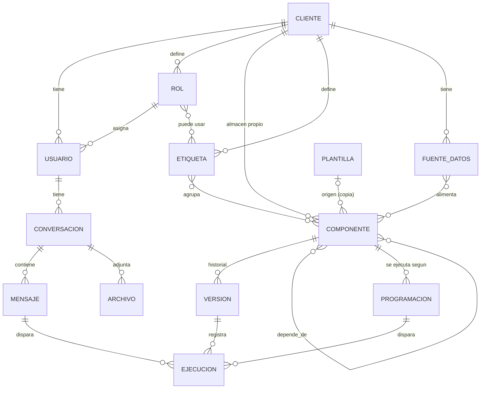
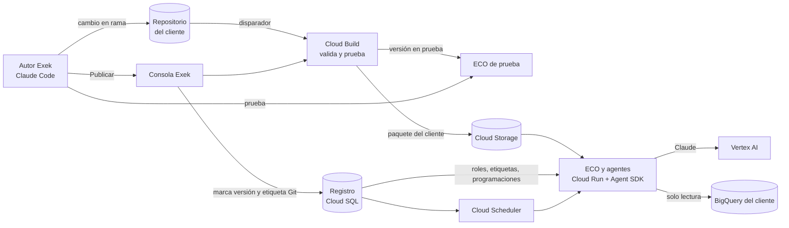

# I-NA · Definiciones: ECO y almacén de componentes

**Documento vivo.** Aquí se registran las definiciones del nuevo diseño a medida que se toman.
**Responsable:** Exek (Dina Silva)
**Última actualización:** 24 de octubre de 2026 (v16: decisiones de la fase 4)

---

## 1. Alcance

| Frente | Qué incluye | Estado |
|---|---|---|
| **1. Portal de clientes** | ECO (chat con IA), listado de artefactos del cliente, listado de agentes del cliente | En espera |
| **2. Plano de control de Exek** | Administración de clientes, usuarios, roles y del **almacén de componentes** de cada cliente (skills, agentes, artefactos, plugins) | **Foco actual** |

**Fuera del nuevo diseño (definido el 22/10/2026):** el árbol Newton. No hay nodos, ni TAROT, ni la navegación por ramas de la versión anterior. Los documentos anteriores (requerimientos v1.1, prototipos de nivel 1 y 2) quedan solo como antecedente.

---

## 2. Principios

1. **Cada cliente es distinto.** Exek tiene una misma filosofía de negocio, pero los datos y funcionalidades de cada cliente son diferentes. Ejemplo: el agente que calcula el ABC de inventarios del cliente A es diferente al del cliente B.
2. **No se busca uniformidad ni réplica de componentes.** Se busca que **cada cliente tenga su propio almacén de componentes**, fácil de administrar.
3. **Lo común entre clientes es la forma de administrar**, no el contenido: los mismos tipos de componente, la misma ficha, los mismos estados y las mismas reglas.
4. **Solo Exek crea y edita componentes.** Los clientes los usan a través de ECO y los ven en sus listados.
5. **Cada personalización es una versión propia** del componente para ese cliente, no un parámetro sobre una versión común.

---

## 3. Glosario

| Término | Definición |
|---|---|
| **ECO** | Asistente de IA del cliente. Conversa con el usuario y usa los componentes del almacén de su cliente para responder. Funciona con modelos Claude. |
| **Almacén de componentes** | Conjunto de componentes que pertenecen a un cliente. Cada cliente tiene el suyo. |
| **Componente** | Pieza que Exek construye para un cliente. Es de uno de estos tipos: skill, agente, artefacto o plugin. |
| **Indicador** | No es un tipo de componente. Los indicadores (fórmula, unidad, meta) se definen dentro de los skills que los calculan y de los artefactos que los muestran. |
| **Skill** | Método o conocimiento: cómo se calcula o se hace algo. Lo usan ECO y los agentes. Ejemplo: clasificación ABC. |
| **Agente** | Componente que actúa solo o a pedido: vigila, alerta, pronostica o propone, usando skills. Ejemplo: alerta de agotados. |
| **Artefacto** | Lo que el usuario mira o descarga: tablero, reporte o listado. |
| **Plugin** | **Extensión técnica**, por ejemplo un conector al ERP del cliente. Trae datos o conecta con un sistema externo. *No* es un paquete comercial. |
| **Paquete del cliente** | Término técnico para el empaquetado en formato de Anthropic con el que se cargan en ECO los componentes de un cliente. Se usa este nombre para no confundirlo con "plugin". |
| **Versión** | Cada estado guardado de un componente. Cada cliente tiene su propio historial. |
| **Plantilla** | Componente de referencia de Exek que sirve como punto de partida. Al usarlo se copia; no queda sincronizado. |
| **Etiqueta** | Palabra que agrupa componentes dentro del almacén de un cliente (por ejemplo, "Inventarios" o "Ventas"). Cada cliente define las suyas. Los permisos de los roles se dan por etiqueta. |

---

## 4. Modelo de datos v4

Reemplaza a los modelos anteriores (v1 tenía la entidad NODO del árbol Newton; v2 daba permisos por componente; v3 no tenía fuentes de datos ni programaciones).



### 4.1 Entidades

| Entidad | Pertenece a | Campos principales | Notas |
|---|---|---|---|
| **CLIENTE** | Exek | nombre, NIT, dominios de correo, estado, repositorio Git, dataset de BigQuery, configuración de ECO | Raíz de todo lo demás. |
| **USUARIO** | Cliente (o Exek si no tiene cliente) | correo, nombre, rol, estado | Los usuarios de Exek administran; los del cliente usan. |
| **ROL** | Cliente | nombre, descripción, etiquetas permitidas | Un usuario tiene un solo rol. El rol da acceso por **etiqueta**: el usuario puede usar los componentes que tengan al menos una de las etiquetas de su rol. |
| **ETIQUETA** | Cliente | nombre, color | Organiza el almacén y define permisos. Es **administrable**: Exek crea, renombra y elimina etiquetas de cada cliente. Un componente puede tener varias etiquetas. |
| **COMPONENTE** | Cliente | tipo, nombre, descripción, dueño en Exek, estado, versión en producción, visible en el portal, origen | Una sola entidad para los cuatro tipos; cada tipo agrega sus campos (4.2). |
| **VERSIÓN** | Componente | número, cambios, commit Git, estado, autor, fecha | Solo una versión en producción por componente. Se puede volver a la anterior. |
| **DEPENDENCIA** | Componente ↔ componente | origen, destino, tipo de relación | Ejemplo: agente usa skill; skill lee de plugin. Sirve para saber qué se afecta si algo cambia. |
| **FUENTE DE DATOS** | Cliente | tipo (tabla o vista de BigQuery, archivo), proyecto, dataset, tabla, descripción, columnas clave | De dónde leen los skills y artefactos. Si los datos ya están en BigQuery, se registran aquí y **no hace falta un plugin**. Un plugin solo se crea cuando hay que traer datos de otro sistema; su tabla de destino queda registrada como fuente. |
| **PROGRAMACIÓN** | Componente (agente o artefacto) | frecuencia (diaria, semanal, mensual o expresión cron), día y hora, zona horaria, activa, destinatarios (roles o usuarios), canal (correo, portal) | Hace que un agente corra solo o que un artefacto se actualice. Un componente puede tener varias. **Solo Exek** las crea y modifica. |
| **PLANTILLA** | Exek | tipo, nombre, descripción, contenido | Opcional. Al usarla se copia al almacén del cliente. |
| **CONVERSACIÓN** | Usuario | título, fijada, fecha | Conversaciones de ECO; se guardan solas, se pueden renombrar y son **privadas de cada usuario** (por ahora). |
| **MENSAJE** | Conversación | autor (usuario o ECO), texto, fecha | |
| **ARCHIVO** | Conversación | nombre, ubicación en Cloud Storage, tabla en BigQuery | Archivos que el usuario sube a ECO. |
| **EJECUCIÓN** | Versión de componente | disparador (ECO, programación, manual), usuario, mensaje, inicio, fin, estado, tokens, costo, resultado | Auditoría y base del cobro de créditos. |

### 4.2 Campos propios por tipo de componente

| Tipo | Campos propios |
|---|---|
| **Skill** | método, parámetros (por ejemplo, umbral de días), fuentes de datos que lee, entradas y salidas, código o SQL, instrucciones (formato SKILL.md), indicadores que calcula (nombre, fórmula, unidad, meta) |
| **Agente** | objetivo, modelo Claude, instrucciones, skills que usa, disparadores (a pedido de ECO y/o programaciones), qué entrega (alerta, listado, reporte) |
| **Artefacto** | tipo (tablero, reporte, listado), fuentes de datos o skills de donde toma los datos, indicadores que muestra, formato, programación de actualización |
| **Plugin** | sistema de origen (ERP, CRM, API, archivo), forma de conexión, credenciales (en Secret Manager), programación de sincronización, fuente de datos de destino en BigQuery, última sincronización. **Solo se usa cuando los datos no están ya en BigQuery.** |

### 4.3 Ciclo de vida de una versión

```
Borrador → En prueba → En producción → Retirada
```

- Solo Exek mueve una versión entre estados. **Quien crea la versión la pasa a producción**; no hay aprobación de otra persona.
- Salvaguarda sugerida: no se puede pasar a producción sin haber estado "en prueba" y sin una nota de cambios; cada paso queda registrado con autor y fecha.
- Una nueva versión se trabaja en borrador sin afectar la que está en producción.
- Al pasar una versión a producción, la anterior queda disponible para volver atrás.

### 4.4 Cómo se conecta con el portal (frente 1)

- **Listado de agentes del cliente** y **listado de artefactos del cliente**: muestran los componentes de ese tipo con *visible en el portal = sí*, en estado *en producción*, con al menos una etiqueta del rol del usuario.
- **ECO** carga el paquete del cliente (sus skills, agentes y plugins en producción) y solo usa los componentes de las etiquetas del rol del usuario.

---

## 5. Decisiones tomadas

| Fecha | Decisión |
|---|---|
| 22/10/2026 | El proyecto se divide en portal de clientes (ECO, listado de artefactos, listado de agentes) y plano de control de Exek. Foco en el plano de control. |
| 22/10/2026 | Cada cliente tiene su propio almacén de componentes. No se busca uniformidad entre clientes. |
| 22/10/2026 | Plugin = extensión técnica (por ejemplo, conector a un ERP). |
| 22/10/2026 | La personalización por cliente se hace con una versión propia del componente. |
| 22/10/2026 | Solo Exek crea y edita componentes. |
| 22/10/2026 | El árbol Newton sale del nuevo diseño. Solo existen ECO y el almacén de componentes. |
| 22/10/2026 | Los permisos de los roles se dan por etiqueta. |
| 22/10/2026 | El indicador no es un tipo de componente: queda dentro de skills y artefactos. |
| 22/10/2026 | Quien crea una versión la pasa a producción, sin aprobación de otra persona. |
| 22/10/2026 | Las conversaciones de ECO son privadas de cada usuario, por el momento. |
| 22/10/2026 | Cliente de ejemplo para validar el modelo: Districash (sección 7). |
| 22/10/2026 | Districash: cliente perdido = más de 60 días sin comprar. |
| 22/10/2026 | Districash: los datos de ventas están en una tabla de BigQuery; no requiere plugin. Se agrega la entidad FUENTE DE DATOS. |
| 22/10/2026 | Los agentes son programables. Se agrega la entidad PROGRAMACIÓN. |
| 22/10/2026 | Districash: el tablero de control gerencia muestra indicadores de ventas. |
| 22/10/2026 | Las etiquetas son administrables. El tablero de gerencia tiene su propia etiqueta: Gerencia. |
| 22/10/2026 | Districash: tabla de ventas de ejemplo `exek-districash.ventas.facturas` (nombres de ejemplo, a reemplazar por los reales). |
| 22/10/2026 | Districash: el agente corre los lunes a las 7:00 a. m. (hora Colombia) y avisa a los roles Comercial y Gerencia por correo y en el portal. |
| 22/10/2026 | Districash: indicadores del tablero aprobados (sección 7.5). |
| 22/10/2026 | Solo Exek crea y cambia programaciones. |
| 22/10/2026 | La definición de cliente perdido es propia de cada cliente de Exek. Para Districash: más de 60 días sin comprar, igual para todos sus clientes. |
| 22/10/2026 | Herramientas del plano de control propuestas (sección 8): Git por cliente, Claude Code para autores, Consola Exek, registro en Cloud SQL, Cloud Build, Agent SDK de Claude en Cloud Run con Vertex AI. Pendiente confirmar P17 a P19. |
| 22/10/2026 | Regla de reparto: en Git va **qué hace** cada componente; en la Consola Exek va **quién lo usa, cuándo corre y qué versión está publicada**. |
| 22/10/2026 | P17: los repositorios van en **GitHub**, en `dinac-maker/INA`. |
| 22/10/2026 | P18: los autores de Exek trabajan con **Claude Code**. |
| 22/10/2026 | P19: la plataforma la construye **el equipo de Exek**. |
| 22/10/2026 | P20: un solo repositorio público, `dinac-maker/EXEK`, con una carpeta por cliente en `clientes/`. |
| 22/10/2026 | P21: validación con GitHub Actions; la revisión en BigQuery se activa con Workload Identity Federation. |
| 22/10/2026 | P16: tabla real de ventas de Districash: `exek-produccion.NewtonAgentSpace.AgentspaceVentas`. |
| 22/10/2026 | Los datos de Districash van del 3/01/2024 al 31/03/2026. Los cálculos usan como **fecha de corte la última factura**, no la fecha de hoy. |
| 22/10/2026 | Proyecto de GCP para ECO: **EXEKAI**. Los datos siguen en `exek-produccion` (solo lectura). |
| 22/10/2026 | P22: la alerta y el tablero muestran solo los clientes perdidos en los **últimos 180 días desde la fecha máxima de los datos** (más de 60 y hasta 180 días sin comprar). El total histórico queda como indicador de referencia. |
| 22/10/2026 | P23: el cliente se identifica y se muestra con `cod_cliente_sucursal` (código\|sucursal); cada sucursal cuenta como un cliente. |
| 22/10/2026 | P24: la tabla de ventas de Districash es **de prueba** por ahora. |
| 22/10/2026 | P25: el ID del proyecto EXEKAI es `exekai`. |
| 22/10/2026 | La construcción continúa en una sesión de Claude Code conectada a `dinac-maker/EXEK` (ver `docs/traspaso-fase2.md`). |
| 22/10/2026 | Fase 2 · Plan aprobado: motor de ECO en `plataforma/eco/` (Agent SDK de Claude por Vertex AI en `exekai`), consulta segura de BigQuery, registro de ejecuciones, pruebas con `pruebas/casos.yaml` y despliegue en Cloud Run. |
| 22/10/2026 | Fase 2 · A: en la fase 2 ECO carga **todos** los componentes de Districash, sin filtrar por rol. El filtro por etiquetas del rol llega con la Consola Exek (fase 3). |
| 22/10/2026 | Fase 2 · B: ECO tiene dos herramientas de BigQuery: `ejecutar_skill` (corre el SQL de un skill con los parámetros de su ficha, que ECO no puede cambiar) y `consulta_libre` (solo `SELECT`, solo tablas declaradas en `fuentes/`, con el límite de bytes del manifiesto y etiquetas de cliente). |
| 22/10/2026 | Fase 2 · C: ECO se prueba también en el computador del autor, con Google Cloud SDK y credenciales propias (`gcloud auth application-default login`), antes de desplegar. |
| 22/10/2026 | Fase 2 · D: el registro de ejecuciones empieza en un archivo JSONL; luego pasa a una tabla de BigQuery en `exekai`. |
| 22/10/2026 | Fase 2: ECO corre con la cuenta de servicio `eco-prueba@exekai.iam.gserviceaccount.com`, con lectura sobre el dataset `exek-produccion:NewtonAgentSpace`. La cuenta `exekai@exekai.iam.gserviceaccount.com` no se usa para ECO. |
| 22/10/2026 | Modelos Claude habilitados en Vertex AI (`exekai`): Sonnet 5.5 (por defecto de ECO), Opus 5.5 y **Haiku 5.5** (en lugar de Haiku 4.5). |
| 22/10/2026 | Preparación de GCP para la fase 2 hecha (pasos 1 a 4 de `docs/gcp-preparacion.md`) y variables `GCP_WIF_PROVIDER` y `GCP_SERVICE_ACCOUNT` creadas en GitHub. El paso de despliegue (Artifact Registry y permisos) queda para el final de la fase. |
| 22/10/2026 | Fase 2: los skills de Districash pasan a v0.2.1. El SQL de clientes perdidos trae los indicadores `clientes_perdidos` y `valor_venta_perdido` calculados sobre todas las filas, y el de indicadores de ventas trae `fecha_corte`; así ECO da cifras exactas aunque lea solo parte de las filas. |
| 22/10/2026 | Fase 2: límites por respuesta de ECO: 25 turnos y USD 2 de costo estimado. Cada consulta devuelve a Claude 50 filas por defecto y 500 como máximo; el total de filas siempre se informa. |
| 22/10/2026 | Fase 2: ECO de prueba en Cloud Run, servicio `eco-districash` en `us-central1`, sin acceso público (rol Invocador de Cloud Run), desplegado a mano con la acción "Desplegar ECO de prueba" de GitHub. |
| 22/10/2026 | Fase 2: los skills de Districash pasan a v0.2.2 tras la primera prueba con Vertex AI: `perdidos_historico` incluye a los perdidos recientes (no son "más de 180 días") y las facturas del ticket promedio no incluyen devoluciones, también al recalcular periodos. |
| 22/10/2026 | Fase 2: ECO probado con Vertex AI desde el computador del autor (Google Cloud SDK con la cuenta de Exek, proyecto de cuota `exekai`): pasan los 5 casos de `pruebas/casos.yaml` y las cifras coinciden con BigQuery. Costo estimado de los 5 casos: USD 0,20 a 0,29. |
| 22/10/2026 | Fase 2: ECO de prueba desplegado en Cloud Run (`eco-districash`, `us-central1`, revisión `eco-districash-00001-qqc`) con la cuenta `eco-prueba`. Sin acceso público: sin credenciales responde 403. Cada ejecución queda en Cloud Logging (`jsonPayload.message = "eco.ejecucion"`). |
| 23/10/2026 | Fase 3 · Consola Exek: plan aprobado. Registro, versiones guardadas por commit, pantallas (clientes, etiquetas y roles, usuarios, almacén, historial), publicar / volver atrás / retirar, y ECO leyendo el registro (paquete publicado y filtro por rol). |
| 23/10/2026 | Fase 3: el registro de la Consola Exek vive en un **dataset de BigQuery** (`exekai.exek_registro`), **en lugar de Cloud SQL**. La consola revisa unicidad y referencias antes de guardar y evita cambios simultáneos sobre el mismo dato; ECO guarda en memoria por unos minutos lo que lee del registro. |
| 23/10/2026 | Fase 3: la consola se construye en **Python**, con páginas armadas en el servidor, y se publica en Cloud Run de `exekai` detrás de **Identity-Aware Proxy (IAP)**. |
| 23/10/2026 | Fase 3: acceso a la consola por un **grupo de Google** de Exek (`consola@exek.co`, lo crea Dina Silva) con los dos correos autorizados. Todos los miembros del grupo tienen acceso total; no hay perfiles internos por ahora. El historial guarda quién hizo cada cambio. |
| 23/10/2026 | Fase 3: las versiones de los componentes salen de **paquetes por commit** que GitHub Actions guarda en Cloud Storage al llegar a `main`; cada versión entra al registro como "en prueba". |
| 23/10/2026 | Fase 3 · D: las etiquetas de versión en Git al publicar (por ejemplo `skill/deteccion-clientes-perdidos/v0.2.2`) se hacen al final de la fase. |
| 23/10/2026 | Fase 3 · E: los usuarios de los clientes solo se registran (correo y rol); el inicio de sesión llega con el portal (fase 6). |
| 23/10/2026 | **Un proyecto de GCP por cliente**, con su propio dataset de BigQuery. El alta de un cliente en la consola pide nombre, dominio de correo, proyecto y dataset; a partir de ahí se crean sus etiquetas, roles, usuarios y componentes. |
| 23/10/2026 | Fase 3: el alta de un cliente crea automáticamente el registro, su carpeta en el repositorio (por solicitud de cambio), su espacio en Cloud Storage y **una cuenta de servicio de ECO solo para ese cliente** (`eco-<cliente>@exekai`). El permiso de lectura sobre el dataset del cliente es **guiado**: la consola muestra el comando y un botón "Verificar acceso". |
| 23/10/2026 | Districash se registra con sus datos actuales (`exek-produccion.NewtonAgentSpace`, de prueba) hasta que tenga proyecto propio. |
| 23/10/2026 | Fase 3: guía de preparación de GCP en `docs/gcp-preparacion-fase3.md`. Registro en el dataset `exekai.exek_registro` (ubicación `US`); paquetes en el bucket `exekai-paquetes` (`us-central1`); la consola corre con la cuenta `consola-exek`. |
| 23/10/2026 | Fase 3: ECO consulta los datos de cada cliente **actuando como la cuenta de ese cliente** (`eco-<cliente>@exekai`, con lectura solo sobre su dataset). La cuenta de ECO solo puede actuar como esas cuentas (rol Creador de tokens de cuenta de servicio). Primer cliente: `eco-districash`. |
| 23/10/2026 | Fase 3: la consola crea la solicitud de cambio de un cliente nuevo con una llave de GitHub de permisos mínimos (solo `dinac-maker/EXEK`: contenido y solicitudes de cambio), guardada en Secret Manager (`github-consola-exek`). |
| 23/10/2026 | Fase 3 (reemplaza la parte automática de la decisión anterior sobre el alta): **crear la cuenta de ECO de cada cliente nuevo también es guiado**, junto con el permiso sobre su dataset. La consola muestra los comandos con los datos del cliente y el botón "Verificar acceso" revisa ambos. Motivo: crearla de forma automática exigiría que la consola administre todas las cuentas de servicio de `exekai` y pueda actuar como cualquiera de ellas. Siguen automáticos el registro, la carpeta en GitHub y el espacio de paquetes. |
| 23/10/2026 | Los permisos sobre datasets de BigQuery se dan editando la lista de accesos del dataset (`bq show` + `bq update --source`, función `dar_acceso` de las guías) o en pantalla, porque `bq add-iam-policy-binding` no está habilitado para datasets en estos proyectos. Preparación de GCP de la fase 3 completa y verificada. |
| 23/10/2026 | `eco-prueba` conserva por ahora permiso de escritura (además de lectura) sobre `exekai.exek_registro`. Se revisará en la fase 4, cuando se decida dónde guarda ECO sus ejecuciones. |
| 23/10/2026 | Districash es la **empresa demo de Exek**; su dominio de correo en el registro es `exek.co`. |
| 23/10/2026 | Fase 3 · Registro construido en `plataforma/registro/` (tablas, reglas, carga inicial y pruebas). Las versiones de cada componente se cargan desde el historial de Git. Estados de una versión (se calculan, no se guardan): **en producción** (la publicada), **en prueba** (más nueva que la publicada; tras volver atrás, las más nuevas quedan en prueba y se pueden volver a publicar) y **anterior** (más vieja que la publicada). |
| 23/10/2026 | Fase 3: las pruebas automáticas del registro corren en memoria y, cuando se pide, contra el dataset `exekai.exek_registro_pruebas`, cuyas tablas se borran solas a las 6 horas. En BigQuery cada operación tarda 1 a 2 segundos: suficiente para la consola, pero la suite completa contra BigQuery tarda unos 45 minutos. |
| 23/10/2026 | Fase 3 · Versiones guardadas: cuando un cambio llega a `main`, la acción "Validar almacenes" deja el paquete de cada cliente que cambió en `gs://exekai-paquetes/<cliente>/commits/<commit>.zip`, con su manifiesto (`.json`) al final. **GitHub solo sube archivos; no escribe en el registro.** La consola lee esos manifiestos y registra las versiones nuevas como "en prueba" (`registro/sincronizar.py`). El manifiesto del paquete ahora incluye la nota de versión y el autor de cada componente. |
| 23/10/2026 | Se guardaron en Cloud Storage los paquetes de los 4 commits con versiones anteriores de Districash (`a8f16cb`, `84db223`, `002fa7e`, `66ca0fe`), armados desde Git, para poder volver a cualquiera de ellas. |
| 23/10/2026 | Fase 3 · Pantallas de la consola construidas en `plataforma/consola/` (Python con FastAPI y páginas armadas en el servidor): almacén con versiones (publicar, volver atrás, retirar, etiquetas y visibilidad), clientes con alta guiada, etiquetas y roles, usuarios e historial, todas con filtros. Encabezado con el logo de Exek. Modo demostración (`python plataforma/consola/demo.py`) con el registro en memoria y sin crear solicitudes en GitHub. |
| 23/10/2026 | Fase 3: el alta guiada de un cliente tiene **cinco** comandos: crear la cuenta de ECO, permiso de consultas, lectura del dataset, permiso para que ECO actúe como la cuenta y permiso para que **la consola** actúe como ella. Este último permite que "Verificar acceso" pruebe de verdad la lectura del dataset (sin traer datos). |
| 23/10/2026 | El identificador de un cliente tiene máximo 26 caracteres, porque la cuenta `eco-<cliente>` no puede pasar de 30 en GCP. |
| 23/10/2026 | Fase 3: la consola se despliega a mano con la acción "Desplegar Consola Exek" de GitHub (servicio `consola-exek` en Cloud Run, `us-central1`, cuenta `consola-exek`, imagen en el repositorio `eco` de Artifact Registry). IAP se activa directamente sobre el servicio de Cloud Run (`--iap`), sin balanceador; la consola verifica el token firmado de IAP en cada petición. Antes de desplegar, la acción corre las pruebas del registro. |
| 23/10/2026 | La subida de paquetes desde GitHub se hace directo con la API de Cloud Storage (`ifGenerationMatch=0`: crear solo si no existe), porque `gcloud storage cp` consulta el destino antes de subir y eso exige permiso de lectura. GitHub sigue con permiso solo de crear archivos en el bucket. |
| 23/10/2026 | Fase 3: **Consola Exek desplegada** en Cloud Run (`consola-exek`, `us-central1`, revisión `consola-exek-00001-zj7`) con IAP. Sin sesión redirige al inicio de sesión de Google; Dina Silva entró con su cuenta de Exek y vio el almacén de Districash sobre el registro real. Pendiente: la pantalla del almacén tarda de 8 a 11 segundos en cargar. |
| 23/10/2026 | Fase 3 · ECO conectado al registro (`plataforma/eco/acceso.py`). **Modo producción** (por defecto en el servicio web): el usuario debe estar registrado y activo; ECO arma el **paquete publicado** con la versión en producción de cada componente de las etiquetas de su rol (cada uno desde el paquete de su commit en Cloud Storage), agrega las skills que usan sus agentes y consulta los datos con la cuenta de su cliente (`eco-<cliente>`; en Cloud Run siempre, en el computador del autor solo con `ECO_ACTUAR_COMO_CLIENTE=1`). **Modo prueba** (por defecto en la terminal y en las pruebas): el almacén del repositorio completo, para los autores de Exek. Lo leído del registro vale 5 minutos. |
| 23/10/2026 | ECO responde, sin llamar a Claude, cuando el usuario no está registrado, está inactivo o su rol no tiene componentes publicados. Si le preguntan por un componente que no es suyo, dice que no lo tiene disponible para su usuario, sin describirlo. |
| 23/10/2026 | Usuarios de prueba en el registro real de Districash: `dina.silva@exek.co` (rol Gerencia) y `comercial.demo@exek.co` (rol Comercial). Probado: Comercial recibe 3 componentes (sin el tablero) y las cifras coinciden con BigQuery; un usuario no registrado es rechazado. |
| 23/10/2026 | Pantallas del almacén y de componente más rápidas: de 8-11 s a 2-3 s contra el registro real (consultas en paralelo, versiones del cliente en una sola consulta y búsqueda de versiones nuevas en segundo plano). |
| 23/10/2026 | **Un solo ECO para todos los clientes**: servicio `eco` en Cloud Run, que reemplaza a `eco-districash`. En modo producción el cliente sale del registro según el correo del usuario; cada cliente sigue con su paquete publicado y su propia cuenta de datos (`eco-<cliente>`). El modo prueba usa Districash por defecto. La acción de despliegue ya no pide cliente y valida todos los almacenes. |
| 23/10/2026 | Consola Exek: **búsqueda en todos los almacenes**, dentro de la pestaña Almacén (selector "Buscar en": el cliente elegido o todos los clientes, conservando el texto buscado). El encabezado dice "I-NA · almacén de componentes". Busca por nombre, identificador, tipo, etiqueta o nota de versión y muestra qué cliente tiene cada componente, con su versión en producción o en prueba; se filtra por tipo, cliente y estado. |
| 23/10/2026 | Fase 3: **ECO único desplegado** en Cloud Run (servicio `eco`) conectado al registro, y consola actualizada (revisión `consola-exek-00002-7qb`). Probado en Cloud Run: Comercial recibe sus 3 componentes y 1.561 clientes perdidos; Gerencia recibe la venta neta de marzo de 2026 ($27.449.812.336); un correo no registrado es rechazado; sin credenciales responde 403. BigQuery confirma que las consultas las hizo `eco-districash@exekai.iam.gserviceaccount.com`. |
| 23/10/2026 | Se eliminó el servicio de Cloud Run `eco-districash` (ECO de la fase 2, último uso el 22/10/2026), reemplazado por `eco`. Se conserva la cuenta `eco-districash@exekai`, que es la cuenta de datos de Districash. Servicios activos en `exekai`: `eco` y `consola-exek`. |
| 24/10/2026 | Fase 3 · D: **al publicar una versión, la consola crea una etiqueta en Git** sobre el commit de esa versión, con el formato `<cliente>/<tipo>/<componente>/v<versión>` (por ejemplo `districash/skill/deteccion-clientes-perdidos/v0.2.2`). Lleva el cliente adelante, a diferencia del ejemplo de la sección 8.4, porque dos clientes pueden tener un componente con el mismo identificador. Cada versión se etiqueta una sola vez; si la etiqueta falla, la publicación igual queda hecha y la consola lo avisa. Las versiones publicadas antes de esto se etiquetan con `python -m consola.etiquetar_publicadas --crear`. |
| 24/10/2026 | Districash: los **periodos relativos se cuentan desde el mes de la fecha de corte**. "El mes pasado" es **el mes anterior al mes de la fecha de corte** (con corte el 31/03/2026, febrero de 2026); "este mes" es el mes de la fecha de corte (se avisa si está incompleto); "este trimestre" y "este año" son los que contienen la fecha de corte. Skill `indicadores-ventas` v0.2.3; el caso de prueba 3 verifica febrero de 2026 y su venta neta ($21.952.197.493). |
| 24/10/2026 | Fase 3: "Verificar acceso" probado con Districash desde la consola desplegada: acceso verificado, registrado a nombre de dina.silva@exek.co (identidad tomada de IAP). La cuenta `consola-exek` puede actuar como `eco-districash` solo para esta verificación. |
| 24/10/2026 | Consola: las confirmaciones (publicar, volver a una versión, retirar, eliminar etiqueta) se muestran **dentro de la página** y no con la ventana del navegador, porque algunos navegadores (como el panel de la app de Claude) la bloquean y el botón parecía no hacer nada. La v0.2.3 de `indicadores-ventas` llegó sola al registro como "en prueba" (commit `cc6f816`). |
| 24/10/2026 | **Fase 3 cerrada.** Primera publicación real de punta a punta: la v0.2.3 de `indicadores-ventas` llegó desde `main` como "en prueba" (GitHub, commit `cc6f816`), Dina Silva la publicó desde la consola desplegada (etiqueta `districash/skill/indicadores-ventas/v0.2.3` creada en GitHub y anotada en el historial) y ECO en producción la usó para Gerencia y Comercial: "el mes pasado" = febrero de 2026, $21.952.197.493. |
| 24/10/2026 | Fase 4 · Programaciones, ejecuciones y costos: plan aprobado. Programaciones de agentes y artefactos, ejecución automática, historial de ejecuciones, correo opcional y módulo de costos por cliente. |
| 24/10/2026 | Fase 4: cada programación tiene **fecha de inicio y fecha de fin** (fuera de ese rango no corre), frecuencia (diaria, semanal, mensual o cada N horas), hora, zona horaria, activa o pausada, y **si envía correo o no** y a quién (roles o correos del cliente). Aplica a **agentes y artefactos**. |
| 24/10/2026 | Fase 4: cada ejecución guarda **fecha y hora de inicio y de fin**, duración, estado, resultado, si se envió correo y a quién, tokens, bytes consultados y costo. **El resultado se guarda siempre**, se envíe correo o no. |
| 24/10/2026 | Fase 4 · A: en esta fase los resultados se ven en la **Consola Exek**; el portal del cliente (fase 6) mostrará esos mismos datos. |
| 24/10/2026 | Fase 4 · B: un solo **reloj de Cloud Scheduler cada 15 minutos** despierta a ECO, que corre lo pendiente. Una tarea puede empezar hasta 15 minutos después de su hora. Hay botón "Ejecutar ahora". |
| 24/10/2026 | Fase 4 · C: las alertas salen de un buzón de Exek (`alertas@exek.co`) con la **API de Gmail**, habilitada por el administrador de Google Workspace. |
| 24/10/2026 | Fase 4 · D: se activa la **exportación de la facturación de GCP a BigQuery** para cuadrar cada mes los costos calculados con lo que Google cobró. |
| 24/10/2026 | Fase 4 · E: cada cliente tiene un **margen o tarifa**; el módulo de costos muestra costo y precio a cobrar. |
| 24/10/2026 | Fase 4 · F: el costo de un cliente incluye también las **conversaciones de sus usuarios con ECO**, no solo las tareas programadas. |
| 24/10/2026 | Fase 4: los agentes corren con el motor de ECO (versión publicada y cuenta del cliente); los artefactos corren las consultas de sus skills y guardan una "foto" de los datos, sin Claude. Claude, BigQuery: costo exacto por ejecución; Cloud Run, Storage y Scheduler: se reparten entre clientes según su uso. |
| 24/10/2026 | Fase 4: guía de preparación en `docs/gcp-preparacion-fase4.md`. Cuentas nuevas: `reloj-exek` (solo puede llamar al servicio `eco`) y `correo-exek` (envía desde `alertas@exek.co` con delegación de Workspace limitada a `gmail.send`; ECO firma con ella sin llaves). Reloj: tarea de Cloud Scheduler `reloj-programaciones` (`*/15 * * * *`, America/Bogota), en pausa hasta desplegar. Facturación exportada al dataset `exekai.facturacion`. ECO escribe las ejecuciones en el registro con el permiso de escritura que ya tiene `eco-prueba`. |
| 24/10/2026 | Fase 4 · Registro ampliado (`registro/calendario.py`, `servicio.py`): programaciones con fechas de inicio y fin, frecuencia (diaria, semanal, mensual, cada N horas), hora, zona horaria y correo sí/no; tabla `ejecuciones` (inicio, fin, duración, estado, resultado, correo, tokens, bytes y costo); margen por cliente. Si el reloj se detiene, al volver corre **una sola vez** la última hora pendiente, siempre que no tenga más de 24 horas de atraso. Solo se corren componentes publicados de clientes activos. Costo de BigQuery con precio de lista (USD 6,25 por TiB), a cuadrar con la facturación. Aplicado al registro real sin tocar datos. |
| 24/10/2026 | Fase 4 · Motor de tareas (`plataforma/eco/tareas.py`, `correo.py`) en el servicio `eco`: `/programaciones/ejecutar-pendientes` (lo llama el reloj) y `/tareas/ejecutar` ("Ejecutar ahora" desde la consola; no envía correo salvo que se pida). Los agentes reciben el resultado de su ejecución anterior para comparar. El correo se arma en HTML (títulos, listas y tablas) y, si falla, la ejecución igual guarda su resultado con el error del correo. Las conversaciones de ECO se anotan como ejecuciones en una sola operación. Probado con datos reales (correo apagado): tablero 18 s, sin costo de Claude; monitor 46 s, USD 0,09. La consola necesita permiso para llamar a `eco` (agregado a la guía). |
| 29/09/2026 (se mantiene) | Toda la IA usa modelos Claude a través de Vertex AI, dentro de GCP. |

---

## 6. Preguntas abiertas

Las preguntas P1 a P15 quedaron resueltas (ver sección 5).

| ID | Pregunta | Propuesta inicial |
|---|---|---|
| — | Sin preguntas abiertas. | |

---

## 7. Ejemplo de validación: Districash

Caso real que comprueba el modelo de punta a punta. Los nombres de tabla y columnas son **de ejemplo** (P16).

### 7.1 Cliente

| Campo | Valor |
|---|---|
| Nombre | Districash |
| Etiquetas | Ventas, Compras, Inventarios, Producción, Consumos, Gerencia |
| Repositorio Git | `districash` *(por crear)* |
| Fuente de datos de ventas | Tabla de BigQuery `exek-districash.ventas.facturas` *(ejemplo)* |

### 7.2 Fuente de datos "Facturas de venta" *(ejemplo)*

| Campo | Valor |
|---|---|
| Tipo | Tabla de BigQuery |
| Ubicación | `exek-districash.ventas.facturas` |
| Descripción | Una fila por línea de factura de venta |
| Columnas clave | `cliente_id` (texto), `cliente_nombre` (texto), `fecha_factura` (fecha), `factura_id` (texto), `valor_neto` (número, pesos), `canal` (texto) |
| Usada por | Skill "Detección de clientes perdidos", Skill "Indicadores de ventas" |

### 7.3 Componentes

```
Districash · almacén de componentes
├── Ventas
│   ├── Agente: Monitor de clientes perdidos
│   │     programación: lunes 7:00 a. m. → roles Comercial y Gerencia (correo y portal)
│   │     usa → Skill: Detección de clientes perdidos (más de 60 días sin comprar)
│   └── Skill: Indicadores de ventas
│         (ambos skills leen de exek-districash.ventas.facturas)
└── Gerencia
    └── Artefacto: Tablero de control gerencia
          muestra → indicadores de los dos skills
```

### 7.4 Ficha: Agente "Monitor de clientes perdidos"

| Campo | Valor |
|---|---|
| Tipo | Agente |
| Etiquetas | Ventas |
| Objetivo | Detectar los clientes que llevan más de 60 días sin comprar, para que el equipo comercial actúe. |
| Modelo Claude | Claude Sonnet |
| Skills que usa | Detección de clientes perdidos |
| Disparadores | A pedido desde ECO y por programación |
| Programación | Semanal, lunes 7:00 a. m., zona horaria America/Bogota, activa |
| Destinatarios | Roles Comercial y Gerencia |
| Canal | Correo y portal |
| Qué entrega | Alerta con el listado de clientes perdidos: cliente, fecha de última compra, días sin comprar, compra promedio mensual, valor dejado de vender. Claude agrega un resumen de 2 a 3 líneas con los casos más relevantes. |
| Visible en el portal | Sí |
| Estado | Borrador, versión 0.1 |

### 7.5 Ficha: Skill "Detección de clientes perdidos"

| Campo | Valor |
|---|---|
| Tipo | Skill |
| Etiquetas | Ventas |
| Método | Un cliente está **perdido** si su última compra fue hace más de **60 días**. Definición propia de Districash; aplica igual a todos sus clientes. |
| Parámetros | `umbral_dias = 60` |
| Fuente de datos | `exek-districash.ventas.facturas` |
| Salidas | Clientes perdidos con fecha de última compra, días sin comprar, compra promedio mensual de los 12 meses anteriores |
| Indicadores que calcula | Número de clientes perdidos; valor de venta perdido (suma de la compra promedio mensual de esos clientes) |
| Visible en el portal | No (lo usan ECO y el agente) |

```sql
-- Districash · Detección de clientes perdidos · v0.1 (nombres de ejemplo)
DECLARE umbral_dias INT64 DEFAULT 60;

WITH ultima AS (
  SELECT cliente_id, ANY_VALUE(cliente_nombre) AS cliente_nombre,
         MAX(fecha_factura) AS ultima_compra
  FROM `exek-districash.ventas.facturas`
  GROUP BY cliente_id
),
historia AS (
  SELECT f.cliente_id, SUM(f.valor_neto) / 12 AS compra_promedio_mensual
  FROM `exek-districash.ventas.facturas` f
  JOIN ultima u USING (cliente_id)
  WHERE f.fecha_factura > DATE_SUB(u.ultima_compra, INTERVAL 12 MONTH)
  GROUP BY f.cliente_id
)
SELECT u.cliente_id, u.cliente_nombre, u.ultima_compra,
       DATE_DIFF(CURRENT_DATE('America/Bogota'), u.ultima_compra, DAY) AS dias_sin_comprar,
       ROUND(h.compra_promedio_mensual) AS compra_promedio_mensual
FROM ultima u
JOIN historia h USING (cliente_id)
WHERE DATE_DIFF(CURRENT_DATE('America/Bogota'), u.ultima_compra, DAY) > umbral_dias
ORDER BY compra_promedio_mensual DESC;
```

### 7.6 Ficha: Skill "Indicadores de ventas"

| Campo | Valor |
|---|---|
| Tipo | Skill |
| Etiquetas | Ventas |
| Fuente de datos | `exek-districash.ventas.facturas` |
| Visible en el portal | No |

| Indicador | Fórmula | Unidad |
|---|---|---|
| Venta neta del mes | Suma de `valor_neto` del mes | Pesos |
| Venta neta acumulada del año | Suma de `valor_neto` desde el 1 de enero | Pesos |
| Variación contra el año anterior | (Venta del mes ÷ venta del mismo mes del año anterior) − 1 | % |
| Clientes activos | Clientes con al menos una factura en los últimos 60 días | Número |
| Ticket promedio | Venta neta del mes ÷ número de facturas del mes | Pesos |
| Frecuencia de compra | Facturas del mes ÷ clientes que compraron en el mes | Veces |
| Clientes nuevos del mes | Clientes cuya primera factura es de este mes | Número |
| Clientes perdidos | Tomado del skill "Detección de clientes perdidos" | Número |

### 7.7 Ficha: Artefacto "Tablero de control gerencia"

| Campo | Valor |
|---|---|
| Tipo | Artefacto · tablero |
| Etiquetas | Gerencia |
| Toma datos de | Skill "Indicadores de ventas" y Skill "Detección de clientes perdidos" |
| Indicadores que muestra | Todos los de 7.6, más valor de venta perdido |
| Programación de actualización | Diaria, 6:00 a. m., America/Bogota |
| Visible en el portal | Sí |

### 7.8 Roles

| Rol | Etiquetas | Ve en el portal | Recibe la alerta de clientes perdidos |
|---|---|---|---|
| Gerencia | Gerencia, Ventas, Compras, Inventarios, Producción, Consumos | Agente de clientes perdidos y tablero de control gerencia | Sí |
| Comercial | Ventas | Agente de clientes perdidos | Sí |
| Compras | Compras, Inventarios | Ninguno de los componentes actuales | No |

### 7.9 Qué se comprobó con el ejemplo

- El modelo funciona sin el árbol: las etiquetas de Districash organizan el almacén y dan los permisos.
- Si los datos ya están en BigQuery, basta con registrar la **fuente de datos**; el plugin queda para traer datos de otros sistemas.
- Los indicadores dentro de skills obligan a tener un skill de indicadores; ese mismo skill le sirve a ECO.
- Una etiqueta propia ("Gerencia") evita que el tablero lo vean todos los roles con Ventas.
- La **programación** es una entidad aparte y solo Exek la cambia.
- Las definiciones de negocio (como "cliente perdido") viven como **parámetros del skill de cada cliente**, coherente con el principio de que cada cliente es distinto.

---

## 8. Herramientas y forma de administración

### 8.1 Regla de reparto

| Qué | Dónde vive | Quién lo cambia | Con qué herramienta |
|---|---|---|---|
| **Qué hace cada componente:** instrucciones, consultas SQL, parámetros (por ejemplo, 60 días), ficha técnica | Repositorio Git del cliente | Autor de Exek | Claude Code + kit de autor |
| Fuentes de datos (tablas de BigQuery que se leen) | Repositorio Git del cliente | Autor de Exek | Claude Code |
| Clientes, usuarios, roles, catálogo de etiquetas, etiquetas de cada componente, visible en el portal | Registro (Cloud SQL) | Administrador Exek | Consola Exek |
| Versión publicada, retiro, volver atrás | Registro + etiqueta de versión en Git | Autor de Exek | Consola Exek (botón Publicar) |
| Programaciones (cuándo corre, a quién avisa) | Registro → Cloud Scheduler | Exek | Consola Exek |
| Credenciales de plugins | Secret Manager | Administrador Exek | Consola Exek |
| Paquete del cliente listo para ECO | Cloud Storage | Automático | Cloud Build |
| Ejecuciones, consumo, conversaciones | Registro y BigQuery | Automático | — |

En palabras simples: **Git guarda el contenido; la consola guarda las decisiones de administración.** Cambiar a quién le llega una alerta o qué rol ve un tablero no exige una versión nueva del componente; cambiar el umbral de 60 días sí.

### 8.2 Herramientas

| Pieza | Herramienta propuesta | Para qué |
|---|---|---|
| Repositorios | **GitHub**, repositorio `dinac-maker/INA` (estructura por definir en P20) | Historial, versiones y respaldo del contenido de cada almacén |
| Trabajo de los autores | **Claude Code** con un **kit de autor de Exek** (comandos para crear componente desde plantilla, validar, probar SQL contra BigQuery y probar en ECO de prueba) | Que los analistas de Exek construyan componentes con ayuda de Claude |
| Administración | **Consola Exek** (aplicación web en Cloud Run) | Clientes, usuarios, roles, etiquetas, almacén, publicar, programar, monitorear |
| Registro | **Cloud SQL para PostgreSQL** | Modelo de datos de la sección 4 |
| Validación y publicación | **GitHub Actions** (propuesta, P21) con acceso a GCP por Workload Identity Federation | Valida, prueba y arma el paquete del cliente |
| Paquetes publicados | **Cloud Storage** | Paquete del cliente por versión, listo para cargar |
| Motor de ECO y agentes | **Claude Agent SDK** en **Cloud Run**, con modelos Claude por **Vertex AI** | Conversaciones de ECO y ejecución de agentes con los skills del cliente |
| Programaciones | **Cloud Scheduler** + **Cloud Run jobs** | Agentes programados y actualización de artefactos |
| Acceso a datos | Herramienta de consulta de BigQuery de la plataforma, de solo lectura, limitada al proyecto del cliente | Que skills y agentes lean datos sin poder tocar otros clientes |

### 8.3 Estructura del repositorio de un cliente

Ejemplo completo en la carpeta `districash-repo-ejemplo`.

```
districash/
├── exek.yaml                       manifiesto técnico del cliente
├── fuentes/facturas.yaml
├── skills/<id>/SKILL.md + componente.yaml + consulta.sql
├── agentes/<id>/agente.md + componente.yaml
├── artefactos/<id>/componente.yaml + tablero.yaml
├── plugins/<id>/componente.yaml + código del conector
└── pruebas/casos.yaml
```

- `SKILL.md` y `agente.md` usan los formatos de Anthropic (skill y subagente), así Claude los entiende sin traducción.
- `componente.yaml` es la ficha de Exek: id, tipo, versión, notas de la versión, autor, origen, skills que usa, fuentes, parámetros, indicadores.
- Al publicar, Cloud Build convierte el repositorio en el **paquete del cliente** con la estructura de plugin de Anthropic (`skills/`, `agents/`, `.mcp.json`), que el Agent SDK carga por ruta local.

### 8.4 Cómo se hace: flujos



**A. Alta de un cliente** (Consola Exek)
1. Crear el cliente: nombre, dominios de correo, proyecto y dataset de BigQuery.
2. La plataforma crea automáticamente el repositorio desde la plantilla, la cuenta de servicio de solo lectura sobre los datos del cliente y su espacio en Cloud Storage.
3. Crear etiquetas, roles (con sus etiquetas) e invitar usuarios.

**B. Crear o cambiar un componente** (Claude Code)
1. El autor abre el repositorio del cliente en Claude Code y usa el kit: "crear skill desde plantilla" o "copiar componente de otro cliente".
2. Escribe o ajusta con ayuda de Claude las instrucciones, el SQL y la ficha; sube el número de versión y la nota de cambios.
3. Prueba el SQL contra BigQuery desde Claude Code.
4. Sube el cambio. Cloud Build valida: estructura y ficha, que existan los skills y fuentes referidos, el SQL en modo de prueba de BigQuery (sin leer datos) y los casos de `pruebas/casos.yaml`.
5. Si pasa, la versión queda **en prueba** y disponible en el ECO de prueba del cliente.

**C. Publicar** (Consola Exek)
1. El autor revisa en el ECO de prueba y pulsa **Publicar** en la consola.
2. La consola registra la versión en producción, crea la etiqueta en Git (por ejemplo, `districash/skill/deteccion-clientes-perdidos/v0.1.0`) y Cloud Build arma el nuevo paquete del cliente.
3. ECO y los agentes del cliente usan el paquete nuevo desde la siguiente conversación o ejecución.

**D. Volver atrás o retirar** (Consola Exek)
- Elegir una versión anterior y publicarla, o marcar el componente como retirado. No requiere tocar Git.

**E. Asignar etiquetas, visibilidad y programaciones** (Consola Exek)
- Cambios inmediatos, sin versión nueva. Al guardar una programación, la plataforma crea o actualiza el trabajo en Cloud Scheduler.

**F. Monitorear** (Consola Exek)
- Ejecuciones por componente (éxito, error, duración), alertas enviadas, consumo de tokens y de BigQuery por cliente.

### 8.5 Cómo usa ECO el almacén en cada conversación

1. El usuario entra; la plataforma identifica su cliente y su rol.
2. Toma el paquete del cliente publicado y deja solo los skills y agentes con etiquetas del rol.
3. Inicia el Agent SDK con ese paquete, el modelo Claude definido y la herramienta de consulta de BigQuery limitada al cliente.
4. Claude elige el skill o agente según la pregunta y su descripción; cada uso queda registrado como ejecución.

### 8.6 Kit de autor de Exek (para Claude Code)

Conjunto de skills y comandos que se instala en Claude Code de cada autor:

| Comando | Qué hace |
|---|---|
| Nuevo componente | Crea la carpeta desde la plantilla del tipo elegido, con la ficha prellenada |
| Copiar de otro cliente | Copia un componente de otro repositorio como versión 0.1.0 y anota el origen |
| Validar | Corre localmente las mismas validaciones de Cloud Build |
| Probar consulta | Ejecuta el SQL contra BigQuery del cliente (entorno de prueba) y muestra el resultado |
| Probar en ECO | Abre una conversación con el ECO de prueba del cliente |

El kit también da a Claude las reglas de la sección 2 y el formato de las fichas, para que ayude a escribir componentes que pasen las validaciones a la primera.

---

## 9. Estado de la construcción

### Fase 1 · Formato del almacén (construida el 22/10/2026)

Repositorio `dinac-maker/EXEK`:

| Pieza | Ruta | Estado |
|---|---|---|
| Reglas de las fichas | `esquemas/` (cliente, fuente, componente por tipo) | Listo |
| Plantillas | `plantillas/` (skill, agente, artefacto, plugin) | Listo |
| Crear componente | `herramientas/nuevo.py` | Listo y probado |
| Validador | `herramientas/validar.py` | Listo y probado: detecta fichas incompletas, referencias rotas, indicadores inexistentes, parámetros SQL no declarados, tablas no declaradas y versiones sin subir |
| Armador del paquete | `herramientas/empaquetar.py` | Listo: genera el paquete en formato de plugin de Anthropic |
| Validación automática | `.github/workflows/validar.yml` | Lista; la revisión en BigQuery espera la configuración de Workload Identity Federation |
| Almacén de Districash | `clientes/districash/` | Listo con la tabla real; los dos SQL se probaron en BigQuery |

**Subida a GitHub el 22/10/2026** (commit "MOver a raiz"): estructura en la raíz, sin archivos de sistema, validación local sin errores.

Pendiente: confirmar en la pestaña *Actions* que la validación corrió en verde, y configurar `GCP_WIF_PROVIDER` y `GCP_SERVICE_ACCOUNT` en GitHub para revisar los SQL en BigQuery.

### Fase 2 · ECO de prueba de Districash (iniciada el 22/10/2026)

Rama `fase2/eco-prueba`.

| Pieza | Ruta | Estado |
|---|---|---|
| Preparación de GCP | `docs/gcp-preparacion.md` | Pasos 1 a 5 hechos |
| Motor de ECO | `plataforma/eco/motor.py` | Listo y probado con Vertex AI (Sonnet 5.5). Solo usa los skills y agentes del paquete y las dos herramientas de consulta; sin terminal ni archivos |
| Consulta segura de BigQuery | `plataforma/eco/consultas.py` | Escrita. Reglas probadas: solo `SELECT`, solo tablas declaradas, límite de bytes, sin `INFORMATION_SCHEMA`, parámetros fijos de los skills |
| Registro de ejecuciones | `plataforma/eco/registro.py` | Escrito: JSONL en `.eco/`; en Cloud Run también en Cloud Logging |
| Uso por terminal y servicio web | `plataforma/eco/__main__.py`, `plataforma/eco/servicio.py` | Escritos |
| Pruebas | `plataforma/eco/pruebas.py` | Pasan los 5 casos (22/10/2026). Entre 3 y 23 segundos y entre USD 0,006 y 0,09 por respuesta |
| Despliegue | `plataforma/eco/Dockerfile`, `.github/workflows/desplegar-eco.yml` | Desplegado el 22/10/2026 en Cloud Run (`eco-districash`, `us-central1`). Probado: sin credenciales responde 403; con credenciales responde bien (1.561 clientes perdidos, 15 s, USD 0,06) y deja el registro en Cloud Logging |
| Skills de Districash | `clientes/districash/skills/` | v0.2.2. SQL probados en BigQuery: 1.561 clientes perdidos, $2.227.171.160 de venta perdida, 4.697 históricos, fecha de corte 31/03/2026 |

**Fase 2 cumplida** (22/10/2026): pasan los 5 casos, las cifras coinciden con BigQuery con la fecha de corte en la respuesta y ECO está desplegado. Mejoras sugeridas: agregar el ticket promedio a las pruebas automáticas, pasar el registro a una tabla de BigQuery y actualizar las versiones de las acciones de GitHub (aviso de Node.js 20). Nota: la prueba automática no revisa el ticket promedio; esa cifra se revisó a mano contra BigQuery ($1.712.682 en ene–mar 2026 frente a $1.601.543 en ene–mar 2025).

### Fase 3 · Consola Exek (iniciada el 23/10/2026)

Ramas `fase3/consola-exek`, `fase3/eco-registro`, `fase3/cierre` y `fase3/mes-pasado`.

| Pieza | Ruta | Estado |
|---|---|---|
| Preparación de GCP | `docs/gcp-preparacion-fase3.md` | Hecha y verificada |
| Registro (tablas, reglas, carga inicial) | `plataforma/registro/` | Listo; Districash cargado en `exekai.exek_registro`, con dos usuarios de prueba |
| Versiones guardadas por commit | `.github/workflows/validar.yml`, `plataforma/registro/paquetes.py`, `sincronizar.py` | Listo y probado en `main` |
| Pantallas de la consola, con búsqueda en todos los clientes | `plataforma/consola/` | Desplegadas y en uso sobre el registro real |
| Publicar, volver atrás y retirar, con etiqueta en Git | `plataforma/consola/app.py`, `consola/github.py` | Desplegado; las 4 versiones publicadas tienen su etiqueta |
| Alta guiada y "Verificar acceso" | `plataforma/consola/alta.py` | Probado con Districash el 24/10/2026: acceso verificado |
| ECO lee el registro (paquete publicado, filtro por rol, cuenta del cliente) | `plataforma/eco/acceso.py`, `registro/paquetes.py` | Servicio `eco` desplegado y probado en Cloud Run |
| Despliegue con IAP | `plataforma/consola/Dockerfile`, `.github/workflows/desplegar-consola.yml` | https://consola-exek-l7kl6xx5kq-uc.a.run.app (solo grupo `consola@exek.co`) |

**Criterios de la fase 3 (plan del 23/10/2026):**

| Criterio | Cumplido |
|---|---|
| Una persona de Exek entra con su cuenta de Google y ve a Districash con sus etiquetas, roles y usuarios | Sí (23/10/2026) |
| ECO usa solo las versiones publicadas | Sí (paquete publicado desde Cloud Storage) |
| El rol Comercial no ve en ECO los componentes de Gerencia | Sí (probado en Cloud Run) |
| Volver a una versión anterior funciona sin tocar Git | Sí (probado en demostración y en pruebas automáticas) |
| Cada cambio queda registrado con quién lo hizo y cuándo | Sí (historial) |

**Fase 3 cerrada el 24/10/2026.** Se cumplieron los cinco criterios y la primera publicación real de punta a punta (v0.2.3 de `indicadores-ventas`, con su etiqueta en Git y usada por ECO en producción). Servicios activos en `exekai`: `consola-exek` (revisión `consola-exek-00004-9vm`) y `eco`.

Mejoras sugeridas para después: actualizar las versiones de las acciones de GitHub (aviso de Node.js 20); guardar las ejecuciones de ECO en una tabla de BigQuery (hoy van a Cloud Logging); revisar en la fase 4 el permiso de escritura de `eco-prueba` sobre el registro.
