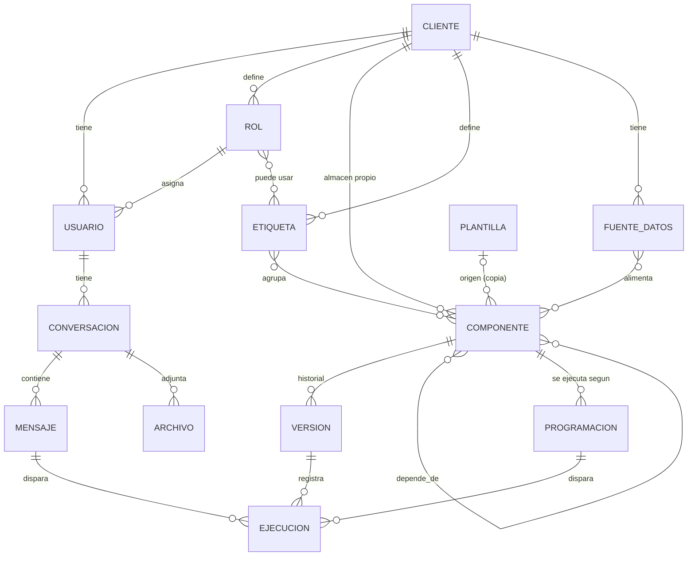
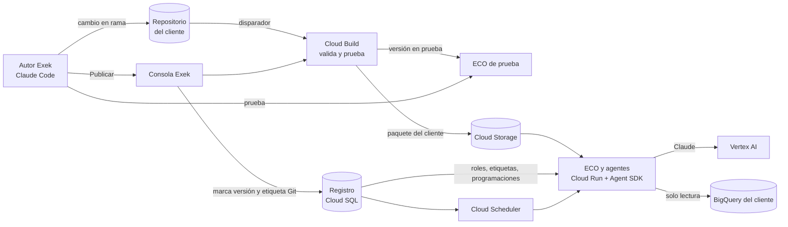

# I-NA · Definiciones: ECO y almacén de componentes

**Documento vivo.** Aquí se registran las definiciones del nuevo diseño a medida que se toman.
**Responsable:** Exek (Dina Silva)
**Última actualización:** 22 de octubre de 2026 (v10: ajustes de Districash y preparación de la fase 2)

---

## 1. Alcance

| Frente | Qué incluye | Estado |
|---|---|---|
| **1. Portal de clientes** | ECO (chat con IA), listado de artefactos del cliente, listado de agentes del cliente | En espera |
| **2. Plano de control de Exek** | Administración de clientes, usuarios, roles y del **almacén de componentes** de cada cliente (skills, agentes, artefactos, plugins) | **Foco actual** |

**Fuera del nuevo diseño (definido el 22/10/2026):** el árbol Newton. No hay nodos, ni TAROT, ni la navegación por ramas de la versión anterior. Los documentos anteriores (requerimientos v1.1, prototipos de nivel 1 y 2) quedan solo como antecedente.

---

## 2. Principios

1. **Cada cliente es distinto.** Exek tiene una misma filosofía de negocio, pero los datos y funcionalidades de cada cliente son diferentes. Ejemplo: el agente que calcula el ABC de inventarios del cliente A es diferente al del cliente B.
2. **No se busca uniformidad ni réplica de componentes.** Se busca que **cada cliente tenga su propio almacén de componentes**, fácil de administrar.
3. **Lo común entre clientes es la forma de administrar**, no el contenido: los mismos tipos de componente, la misma ficha, los mismos estados y las mismas reglas.
4. **Solo Exek crea y edita componentes.** Los clientes los usan a través de ECO y los ven en sus listados.
5. **Cada personalización es una versión propia** del componente para ese cliente, no un parámetro sobre una versión común.

---

## 3. Glosario

| Término | Definición |
|---|---|
| **ECO** | Asistente de IA del cliente. Conversa con el usuario y usa los componentes del almacén de su cliente para responder. Funciona con modelos Claude. |
| **Almacén de componentes** | Conjunto de componentes que pertenecen a un cliente. Cada cliente tiene el suyo. |
| **Componente** | Pieza que Exek construye para un cliente. Es de uno de estos tipos: skill, agente, artefacto o plugin. |
| **Indicador** | No es un tipo de componente. Los indicadores (fórmula, unidad, meta) se definen dentro de los skills que los calculan y de los artefactos que los muestran. |
| **Skill** | Método o conocimiento: cómo se calcula o se hace algo. Lo usan ECO y los agentes. Ejemplo: clasificación ABC. |
| **Agente** | Componente que actúa solo o a pedido: vigila, alerta, pronostica o propone, usando skills. Ejemplo: alerta de agotados. |
| **Artefacto** | Lo que el usuario mira o descarga: tablero, reporte o listado. |
| **Plugin** | **Extensión técnica**, por ejemplo un conector al ERP del cliente. Trae datos o conecta con un sistema externo. *No* es un paquete comercial. |
| **Paquete del cliente** | Término técnico para el empaquetado en formato de Anthropic con el que se cargan en ECO los componentes de un cliente. Se usa este nombre para no confundirlo con "plugin". |
| **Versión** | Cada estado guardado de un componente. Cada cliente tiene su propio historial. |
| **Plantilla** | Componente de referencia de Exek que sirve como punto de partida. Al usarlo se copia; no queda sincronizado. |
| **Etiqueta** | Palabra que agrupa componentes dentro del almacén de un cliente (por ejemplo, "Inventarios" o "Ventas"). Cada cliente define las suyas. Los permisos de los roles se dan por etiqueta. |

---

## 4. Modelo de datos v4

Reemplaza a los modelos anteriores (v1 tenía la entidad NODO del árbol Newton; v2 daba permisos por componente; v3 no tenía fuentes de datos ni programaciones).



### 4.1 Entidades

| Entidad | Pertenece a | Campos principales | Notas |
|---|---|---|---|
| **CLIENTE** | Exek | nombre, NIT, dominios de correo, estado, repositorio Git, dataset de BigQuery, configuración de ECO | Raíz de todo lo demás. |
| **USUARIO** | Cliente (o Exek si no tiene cliente) | correo, nombre, rol, estado | Los usuarios de Exek administran; los del cliente usan. |
| **ROL** | Cliente | nombre, descripción, etiquetas permitidas | Un usuario tiene un solo rol. El rol da acceso por **etiqueta**: el usuario puede usar los componentes que tengan al menos una de las etiquetas de su rol. |
| **ETIQUETA** | Cliente | nombre, color | Organiza el almacén y define permisos. Es **administrable**: Exek crea, renombra y elimina etiquetas de cada cliente. Un componente puede tener varias etiquetas. |
| **COMPONENTE** | Cliente | tipo, nombre, descripción, dueño en Exek, estado, versión en producción, visible en el portal, origen | Una sola entidad para los cuatro tipos; cada tipo agrega sus campos (4.2). |
| **VERSIÓN** | Componente | número, cambios, commit Git, estado, autor, fecha | Solo una versión en producción por componente. Se puede volver a la anterior. |
| **DEPENDENCIA** | Componente ↔ componente | origen, destino, tipo de relación | Ejemplo: agente usa skill; skill lee de plugin. Sirve para saber qué se afecta si algo cambia. |
| **FUENTE DE DATOS** | Cliente | tipo (tabla o vista de BigQuery, archivo), proyecto, dataset, tabla, descripción, columnas clave | De dónde leen los skills y artefactos. Si los datos ya están en BigQuery, se registran aquí y **no hace falta un plugin**. Un plugin solo se crea cuando hay que traer datos de otro sistema; su tabla de destino queda registrada como fuente. |
| **PROGRAMACIÓN** | Componente (agente o artefacto) | frecuencia (diaria, semanal, mensual o expresión cron), día y hora, zona horaria, activa, destinatarios (roles o usuarios), canal (correo, portal) | Hace que un agente corra solo o que un artefacto se actualice. Un componente puede tener varias. **Solo Exek** las crea y modifica. |
| **PLANTILLA** | Exek | tipo, nombre, descripción, contenido | Opcional. Al usarla se copia al almacén del cliente. |
| **CONVERSACIÓN** | Usuario | título, fijada, fecha | Conversaciones de ECO; se guardan solas, se pueden renombrar y son **privadas de cada usuario** (por ahora). |
| **MENSAJE** | Conversación | autor (usuario o ECO), texto, fecha | |
| **ARCHIVO** | Conversación | nombre, ubicación en Cloud Storage, tabla en BigQuery | Archivos que el usuario sube a ECO. |
| **EJECUCIÓN** | Versión de componente | disparador (ECO, programación, manual), usuario, mensaje, inicio, fin, estado, tokens, costo, resultado | Auditoría y base del cobro de créditos. |

### 4.2 Campos propios por tipo de componente

| Tipo | Campos propios |
|---|---|
| **Skill** | método, parámetros (por ejemplo, umbral de días), fuentes de datos que lee, entradas y salidas, código o SQL, instrucciones (formato SKILL.md), indicadores que calcula (nombre, fórmula, unidad, meta) |
| **Agente** | objetivo, modelo Claude, instrucciones, skills que usa, disparadores (a pedido de ECO y/o programaciones), qué entrega (alerta, listado, reporte) |
| **Artefacto** | tipo (tablero, reporte, listado), fuentes de datos o skills de donde toma los datos, indicadores que muestra, formato, programación de actualización |
| **Plugin** | sistema de origen (ERP, CRM, API, archivo), forma de conexión, credenciales (en Secret Manager), programación de sincronización, fuente de datos de destino en BigQuery, última sincronización. **Solo se usa cuando los datos no están ya en BigQuery.** |

### 4.3 Ciclo de vida de una versión

```
Borrador → En prueba → En producción → Retirada
```

- Solo Exek mueve una versión entre estados. **Quien crea la versión la pasa a producción**; no hay aprobación de otra persona.
- Salvaguarda sugerida: no se puede pasar a producción sin haber estado "en prueba" y sin una nota de cambios; cada paso queda registrado con autor y fecha.
- Una nueva versión se trabaja en borrador sin afectar la que está en producción.
- Al pasar una versión a producción, la anterior queda disponible para volver atrás.

### 4.4 Cómo se conecta con el portal (frente 1)

- **Listado de agentes del cliente** y **listado de artefactos del cliente**: muestran los componentes de ese tipo con *visible en el portal = sí*, en estado *en producción*, con al menos una etiqueta del rol del usuario.
- **ECO** carga el paquete del cliente (sus skills, agentes y plugins en producción) y solo usa los componentes de las etiquetas del rol del usuario.

---

## 5. Decisiones tomadas

| Fecha | Decisión |
|---|---|
| 22/10/2026 | El proyecto se divide en portal de clientes (ECO, listado de artefactos, listado de agentes) y plano de control de Exek. Foco en el plano de control. |
| 22/10/2026 | Cada cliente tiene su propio almacén de componentes. No se busca uniformidad entre clientes. |
| 22/10/2026 | Plugin = extensión técnica (por ejemplo, conector a un ERP). |
| 22/10/2026 | La personalización por cliente se hace con una versión propia del componente. |
| 22/10/2026 | Solo Exek crea y edita componentes. |
| 22/10/2026 | El árbol Newton sale del nuevo diseño. Solo existen ECO y el almacén de componentes. |
| 22/10/2026 | Los permisos de los roles se dan por etiqueta. |
| 22/10/2026 | El indicador no es un tipo de componente: queda dentro de skills y artefactos. |
| 22/10/2026 | Quien crea una versión la pasa a producción, sin aprobación de otra persona. |
| 22/10/2026 | Las conversaciones de ECO son privadas de cada usuario, por el momento. |
| 22/10/2026 | Cliente de ejemplo para validar el modelo: Districash (sección 7). |
| 22/10/2026 | Districash: cliente perdido = más de 60 días sin comprar. |
| 22/10/2026 | Districash: los datos de ventas están en una tabla de BigQuery; no requiere plugin. Se agrega la entidad FUENTE DE DATOS. |
| 22/10/2026 | Los agentes son programables. Se agrega la entidad PROGRAMACIÓN. |
| 22/10/2026 | Districash: el tablero de control gerencia muestra indicadores de ventas. |
| 22/10/2026 | Las etiquetas son administrables. El tablero de gerencia tiene su propia etiqueta: Gerencia. |
| 22/10/2026 | Districash: tabla de ventas de ejemplo `exek-districash.ventas.facturas` (nombres de ejemplo, a reemplazar por los reales). |
| 22/10/2026 | Districash: el agente corre los lunes a las 7:00 a. m. (hora Colombia) y avisa a los roles Comercial y Gerencia por correo y en el portal. |
| 22/10/2026 | Districash: indicadores del tablero aprobados (sección 7.5). |
| 22/10/2026 | Solo Exek crea y cambia programaciones. |
| 22/10/2026 | La definición de cliente perdido es propia de cada cliente de Exek. Para Districash: más de 60 días sin comprar, igual para todos sus clientes. |
| 22/10/2026 | Herramientas del plano de control propuestas (sección 8): Git por cliente, Claude Code para autores, Consola Exek, registro en Cloud SQL, Cloud Build, Agent SDK de Claude en Cloud Run con Vertex AI. Pendiente confirmar P17 a P19. |
| 22/10/2026 | Regla de reparto: en Git va **qué hace** cada componente; en la Consola Exek va **quién lo usa, cuándo corre y qué versión está publicada**. |
| 22/10/2026 | P17: los repositorios van en **GitHub**, en `dinac-maker/INA`. |
| 22/10/2026 | P18: los autores de Exek trabajan con **Claude Code**. |
| 22/10/2026 | P19: la plataforma la construye **el equipo de Exek**. |
| 22/10/2026 | P20: un solo repositorio público, `dinac-maker/EXEK`, con una carpeta por cliente en `clientes/`. |
| 22/10/2026 | P21: validación con GitHub Actions; la revisión en BigQuery se activa con Workload Identity Federation. |
| 22/10/2026 | P16: tabla real de ventas de Districash: `exek-produccion.NewtonAgentSpace.AgentspaceVentas`. |
| 22/10/2026 | Los datos de Districash van del 3/01/2024 al 31/03/2026. Los cálculos usan como **fecha de corte la última factura**, no la fecha de hoy. |
| 22/10/2026 | Proyecto de GCP para ECO: **EXEKAI**. Los datos siguen en `exek-produccion` (solo lectura). |
| 22/10/2026 | P22: la alerta y el tablero muestran solo los clientes perdidos en los **últimos 180 días desde la fecha máxima de los datos** (más de 60 y hasta 180 días sin comprar). El total histórico queda como indicador de referencia. |
| 22/10/2026 | P23: el cliente se identifica y se muestra con `cod_cliente_sucursal` (código\|sucursal); cada sucursal cuenta como un cliente. |
| 22/10/2026 | P24: la tabla de ventas de Districash es **de prueba** por ahora. |
| 29/09/2026 (se mantiene) | Toda la IA usa modelos Claude a través de Vertex AI, dentro de GCP. |

---

## 6. Preguntas abiertas

Las preguntas P1 a P15 quedaron resueltas (ver sección 5).

| ID | Pregunta | Propuesta inicial |
|---|---|---|
| P25 | ID exacto del proyecto EXEKAI en GCP (el ID va en minúsculas). | Lo entrega quien prepare GCP con `docs/gcp-preparacion.md`. |

---|---|---|
| P16 | Confirmar los nombres reales de la tabla de ventas de Districash y sus columnas. | En el ejemplo se usan nombres de referencia. |

---

## 7. Ejemplo de validación: Districash

Caso real que comprueba el modelo de punta a punta. Los nombres de tabla y columnas son **de ejemplo** (P16).

### 7.1 Cliente

| Campo | Valor |
|---|---|
| Nombre | Districash |
| Etiquetas | Ventas, Compras, Inventarios, Producción, Consumos, Gerencia |
| Repositorio Git | `districash` *(por crear)* |
| Fuente de datos de ventas | Tabla de BigQuery `exek-districash.ventas.facturas` *(ejemplo)* |

### 7.2 Fuente de datos "Facturas de venta" *(ejemplo)*

| Campo | Valor |
|---|---|
| Tipo | Tabla de BigQuery |
| Ubicación | `exek-districash.ventas.facturas` |
| Descripción | Una fila por línea de factura de venta |
| Columnas clave | `cliente_id` (texto), `cliente_nombre` (texto), `fecha_factura` (fecha), `factura_id` (texto), `valor_neto` (número, pesos), `canal` (texto) |
| Usada por | Skill "Detección de clientes perdidos", Skill "Indicadores de ventas" |

### 7.3 Componentes

```
Districash · almacén de componentes
├── Ventas
│   ├── Agente: Monitor de clientes perdidos
│   │     programación: lunes 7:00 a. m. → roles Comercial y Gerencia (correo y portal)
│   │     usa → Skill: Detección de clientes perdidos (más de 60 días sin comprar)
│   └── Skill: Indicadores de ventas
│         (ambos skills leen de exek-districash.ventas.facturas)
└── Gerencia
    └── Artefacto: Tablero de control gerencia
          muestra → indicadores de los dos skills
```

### 7.4 Ficha: Agente "Monitor de clientes perdidos"

| Campo | Valor |
|---|---|
| Tipo | Agente |
| Etiquetas | Ventas |
| Objetivo | Detectar los clientes que llevan más de 60 días sin comprar, para que el equipo comercial actúe. |
| Modelo Claude | Claude Sonnet |
| Skills que usa | Detección de clientes perdidos |
| Disparadores | A pedido desde ECO y por programación |
| Programación | Semanal, lunes 7:00 a. m., zona horaria America/Bogota, activa |
| Destinatarios | Roles Comercial y Gerencia |
| Canal | Correo y portal |
| Qué entrega | Alerta con el listado de clientes perdidos: cliente, fecha de última compra, días sin comprar, compra promedio mensual, valor dejado de vender. Claude agrega un resumen de 2 a 3 líneas con los casos más relevantes. |
| Visible en el portal | Sí |
| Estado | Borrador, versión 0.1 |

### 7.5 Ficha: Skill "Detección de clientes perdidos"

| Campo | Valor |
|---|---|
| Tipo | Skill |
| Etiquetas | Ventas |
| Método | Un cliente está **perdido** si su última compra fue hace más de **60 días**. Definición propia de Districash; aplica igual a todos sus clientes. |
| Parámetros | `umbral_dias = 60` |
| Fuente de datos | `exek-districash.ventas.facturas` |
| Salidas | Clientes perdidos con fecha de última compra, días sin comprar, compra promedio mensual de los 12 meses anteriores |
| Indicadores que calcula | Número de clientes perdidos; valor de venta perdido (suma de la compra promedio mensual de esos clientes) |
| Visible en el portal | No (lo usan ECO y el agente) |

```sql
-- Districash · Detección de clientes perdidos · v0.1 (nombres de ejemplo)
DECLARE umbral_dias INT64 DEFAULT 60;

WITH ultima AS (
  SELECT cliente_id, ANY_VALUE(cliente_nombre) AS cliente_nombre,
         MAX(fecha_factura) AS ultima_compra
  FROM `exek-districash.ventas.facturas`
  GROUP BY cliente_id
),
historia AS (
  SELECT f.cliente_id, SUM(f.valor_neto) / 12 AS compra_promedio_mensual
  FROM `exek-districash.ventas.facturas` f
  JOIN ultima u USING (cliente_id)
  WHERE f.fecha_factura > DATE_SUB(u.ultima_compra, INTERVAL 12 MONTH)
  GROUP BY f.cliente_id
)
SELECT u.cliente_id, u.cliente_nombre, u.ultima_compra,
       DATE_DIFF(CURRENT_DATE('America/Bogota'), u.ultima_compra, DAY) AS dias_sin_comprar,
       ROUND(h.compra_promedio_mensual) AS compra_promedio_mensual
FROM ultima u
JOIN historia h USING (cliente_id)
WHERE DATE_DIFF(CURRENT_DATE('America/Bogota'), u.ultima_compra, DAY) > umbral_dias
ORDER BY compra_promedio_mensual DESC;
```

### 7.6 Ficha: Skill "Indicadores de ventas"

| Campo | Valor |
|---|---|
| Tipo | Skill |
| Etiquetas | Ventas |
| Fuente de datos | `exek-districash.ventas.facturas` |
| Visible en el portal | No |

| Indicador | Fórmula | Unidad |
|---|---|---|
| Venta neta del mes | Suma de `valor_neto` del mes | Pesos |
| Venta neta acumulada del año | Suma de `valor_neto` desde el 1 de enero | Pesos |
| Variación contra el año anterior | (Venta del mes ÷ venta del mismo mes del año anterior) − 1 | % |
| Clientes activos | Clientes con al menos una factura en los últimos 60 días | Número |
| Ticket promedio | Venta neta del mes ÷ número de facturas del mes | Pesos |
| Frecuencia de compra | Facturas del mes ÷ clientes que compraron en el mes | Veces |
| Clientes nuevos del mes | Clientes cuya primera factura es de este mes | Número |
| Clientes perdidos | Tomado del skill "Detección de clientes perdidos" | Número |

### 7.7 Ficha: Artefacto "Tablero de control gerencia"

| Campo | Valor |
|---|---|
| Tipo | Artefacto · tablero |
| Etiquetas | Gerencia |
| Toma datos de | Skill "Indicadores de ventas" y Skill "Detección de clientes perdidos" |
| Indicadores que muestra | Todos los de 7.6, más valor de venta perdido |
| Programación de actualización | Diaria, 6:00 a. m., America/Bogota |
| Visible en el portal | Sí |

### 7.8 Roles

| Rol | Etiquetas | Ve en el portal | Recibe la alerta de clientes perdidos |
|---|---|---|---|
| Gerencia | Gerencia, Ventas, Compras, Inventarios, Producción, Consumos | Agente de clientes perdidos y tablero de control gerencia | Sí |
| Comercial | Ventas | Agente de clientes perdidos | Sí |
| Compras | Compras, Inventarios | Ninguno de los componentes actuales | No |

### 7.9 Qué se comprobó con el ejemplo

- El modelo funciona sin el árbol: las etiquetas de Districash organizan el almacén y dan los permisos.
- Si los datos ya están en BigQuery, basta con registrar la **fuente de datos**; el plugin queda para traer datos de otros sistemas.
- Los indicadores dentro de skills obligan a tener un skill de indicadores; ese mismo skill le sirve a ECO.
- Una etiqueta propia ("Gerencia") evita que el tablero lo vean todos los roles con Ventas.
- La **programación** es una entidad aparte y solo Exek la cambia.
- Las definiciones de negocio (como "cliente perdido") viven como **parámetros del skill de cada cliente**, coherente con el principio de que cada cliente es distinto.

---

## 8. Herramientas y forma de administración

### 8.1 Regla de reparto

| Qué | Dónde vive | Quién lo cambia | Con qué herramienta |
|---|---|---|---|
| **Qué hace cada componente:** instrucciones, consultas SQL, parámetros (por ejemplo, 60 días), ficha técnica | Repositorio Git del cliente | Autor de Exek | Claude Code + kit de autor |
| Fuentes de datos (tablas de BigQuery que se leen) | Repositorio Git del cliente | Autor de Exek | Claude Code |
| Clientes, usuarios, roles, catálogo de etiquetas, etiquetas de cada componente, visible en el portal | Registro (Cloud SQL) | Administrador Exek | Consola Exek |
| Versión publicada, retiro, volver atrás | Registro + etiqueta de versión en Git | Autor de Exek | Consola Exek (botón Publicar) |
| Programaciones (cuándo corre, a quién avisa) | Registro → Cloud Scheduler | Exek | Consola Exek |
| Credenciales de plugins | Secret Manager | Administrador Exek | Consola Exek |
| Paquete del cliente listo para ECO | Cloud Storage | Automático | Cloud Build |
| Ejecuciones, consumo, conversaciones | Registro y BigQuery | Automático | — |

En palabras simples: **Git guarda el contenido; la consola guarda las decisiones de administración.** Cambiar a quién le llega una alerta o qué rol ve un tablero no exige una versión nueva del componente; cambiar el umbral de 60 días sí.

### 8.2 Herramientas

| Pieza | Herramienta propuesta | Para qué |
|---|---|---|
| Repositorios | **GitHub**, repositorio `dinac-maker/INA` (estructura por definir en P20) | Historial, versiones y respaldo del contenido de cada almacén |
| Trabajo de los autores | **Claude Code** con un **kit de autor de Exek** (comandos para crear componente desde plantilla, validar, probar SQL contra BigQuery y probar en ECO de prueba) | Que los analistas de Exek construyan componentes con ayuda de Claude |
| Administración | **Consola Exek** (aplicación web en Cloud Run) | Clientes, usuarios, roles, etiquetas, almacén, publicar, programar, monitorear |
| Registro | **Cloud SQL para PostgreSQL** | Modelo de datos de la sección 4 |
| Validación y publicación | **GitHub Actions** (propuesta, P21) con acceso a GCP por Workload Identity Federation | Valida, prueba y arma el paquete del cliente |
| Paquetes publicados | **Cloud Storage** | Paquete del cliente por versión, listo para cargar |
| Motor de ECO y agentes | **Claude Agent SDK** en **Cloud Run**, con modelos Claude por **Vertex AI** | Conversaciones de ECO y ejecución de agentes con los skills del cliente |
| Programaciones | **Cloud Scheduler** + **Cloud Run jobs** | Agentes programados y actualización de artefactos |
| Acceso a datos | Herramienta de consulta de BigQuery de la plataforma, de solo lectura, limitada al proyecto del cliente | Que skills y agentes lean datos sin poder tocar otros clientes |

### 8.3 Estructura del repositorio de un cliente

Ejemplo completo en la carpeta `districash-repo-ejemplo`.

```
districash/
├── exek.yaml                       manifiesto técnico del cliente
├── fuentes/facturas.yaml
├── skills/<id>/SKILL.md + componente.yaml + consulta.sql
├── agentes/<id>/agente.md + componente.yaml
├── artefactos/<id>/componente.yaml + tablero.yaml
├── plugins/<id>/componente.yaml + código del conector
└── pruebas/casos.yaml
```

- `SKILL.md` y `agente.md` usan los formatos de Anthropic (skill y subagente), así Claude los entiende sin traducción.
- `componente.yaml` es la ficha de Exek: id, tipo, versión, notas de la versión, autor, origen, skills que usa, fuentes, parámetros, indicadores.
- Al publicar, Cloud Build convierte el repositorio en el **paquete del cliente** con la estructura de plugin de Anthropic (`skills/`, `agents/`, `.mcp.json`), que el Agent SDK carga por ruta local.

### 8.4 Cómo se hace: flujos



**A. Alta de un cliente** (Consola Exek)
1. Crear el cliente: nombre, dominios de correo, proyecto y dataset de BigQuery.
2. La plataforma crea automáticamente el repositorio desde la plantilla, la cuenta de servicio de solo lectura sobre los datos del cliente y su espacio en Cloud Storage.
3. Crear etiquetas, roles (con sus etiquetas) e invitar usuarios.

**B. Crear o cambiar un componente** (Claude Code)
1. El autor abre el repositorio del cliente en Claude Code y usa el kit: "crear skill desde plantilla" o "copiar componente de otro cliente".
2. Escribe o ajusta con ayuda de Claude las instrucciones, el SQL y la ficha; sube el número de versión y la nota de cambios.
3. Prueba el SQL contra BigQuery desde Claude Code.
4. Sube el cambio. Cloud Build valida: estructura y ficha, que existan los skills y fuentes referidos, el SQL en modo de prueba de BigQuery (sin leer datos) y los casos de `pruebas/casos.yaml`.
5. Si pasa, la versión queda **en prueba** y disponible en el ECO de prueba del cliente.

**C. Publicar** (Consola Exek)
1. El autor revisa en el ECO de prueba y pulsa **Publicar** en la consola.
2. La consola registra la versión en producción, crea la etiqueta en Git (por ejemplo, `skill/deteccion-clientes-perdidos/v0.1.0`) y Cloud Build arma el nuevo paquete del cliente.
3. ECO y los agentes del cliente usan el paquete nuevo desde la siguiente conversación o ejecución.

**D. Volver atrás o retirar** (Consola Exek)
- Elegir una versión anterior y publicarla, o marcar el componente como retirado. No requiere tocar Git.

**E. Asignar etiquetas, visibilidad y programaciones** (Consola Exek)
- Cambios inmediatos, sin versión nueva. Al guardar una programación, la plataforma crea o actualiza el trabajo en Cloud Scheduler.

**F. Monitorear** (Consola Exek)
- Ejecuciones por componente (éxito, error, duración), alertas enviadas, consumo de tokens y de BigQuery por cliente.

### 8.5 Cómo usa ECO el almacén en cada conversación

1. El usuario entra; la plataforma identifica su cliente y su rol.
2. Toma el paquete del cliente publicado y deja solo los skills y agentes con etiquetas del rol.
3. Inicia el Agent SDK con ese paquete, el modelo Claude definido y la herramienta de consulta de BigQuery limitada al cliente.
4. Claude elige el skill o agente según la pregunta y su descripción; cada uso queda registrado como ejecución.

### 8.6 Kit de autor de Exek (para Claude Code)

Conjunto de skills y comandos que se instala en Claude Code de cada autor:

| Comando | Qué hace |
|---|---|
| Nuevo componente | Crea la carpeta desde la plantilla del tipo elegido, con la ficha prellenada |
| Copiar de otro cliente | Copia un componente de otro repositorio como versión 0.1.0 y anota el origen |
| Validar | Corre localmente las mismas validaciones de Cloud Build |
| Probar consulta | Ejecuta el SQL contra BigQuery del cliente (entorno de prueba) y muestra el resultado |
| Probar en ECO | Abre una conversación con el ECO de prueba del cliente |

El kit también da a Claude las reglas de la sección 2 y el formato de las fichas, para que ayude a escribir componentes que pasen las validaciones a la primera.

---

## 9. Estado de la construcción

### Fase 1 · Formato del almacén (construida el 22/10/2026)

Repositorio `dinac-maker/EXEK`:

| Pieza | Ruta | Estado |
|---|---|---|
| Reglas de las fichas | `esquemas/` (cliente, fuente, componente por tipo) | Listo |
| Plantillas | `plantillas/` (skill, agente, artefacto, plugin) | Listo |
| Crear componente | `herramientas/nuevo.py` | Listo y probado |
| Validador | `herramientas/validar.py` | Listo y probado: detecta fichas incompletas, referencias rotas, indicadores inexistentes, parámetros SQL no declarados, tablas no declaradas y versiones sin subir |
| Armador del paquete | `herramientas/empaquetar.py` | Listo: genera el paquete en formato de plugin de Anthropic |
| Validación automática | `.github/workflows/validar.yml` | Lista; la revisión en BigQuery espera la configuración de Workload Identity Federation |
| Almacén de Districash | `clientes/districash/` | Listo con la tabla real; los dos SQL se probaron en BigQuery |

**Subida a GitHub el 22/10/2026** (commit "MOver a raiz"): estructura en la raíz, sin archivos de sistema, validación local sin errores.

Pendiente: confirmar en la pestaña *Actions* que la validación corrió en verde, y configurar `GCP_WIF_PROVIDER` y `GCP_SERVICE_ACCOUNT` en GitHub para revisar los SQL en BigQuery.

